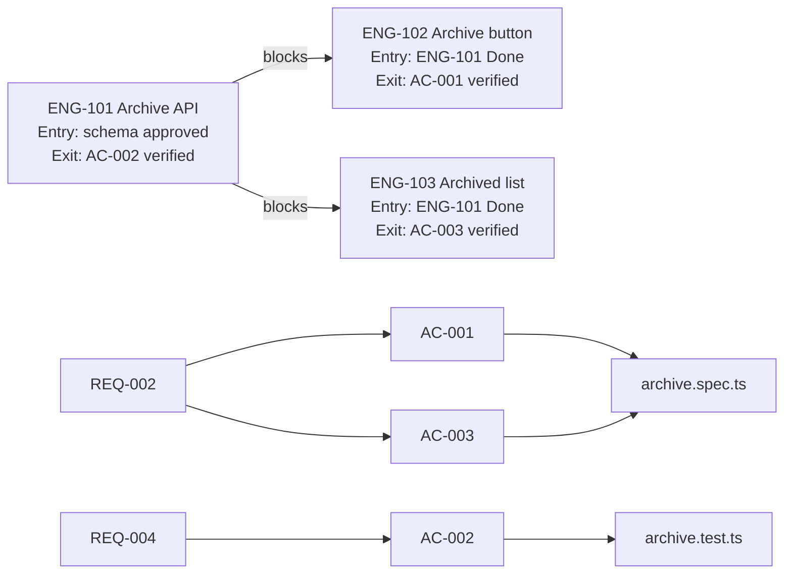

# Gherkin acceptance criteria, traceability, and Mermaid diagrams

Read this when you write the **Acceptance criteria** and **Traceability** sections of an issue, or a plan with dependencies.

## Gherkin acceptance criteria

- Write **one Gherkin scenario per AC**, and **at least one AC per REQ**.
- Each AC stays a `- [ ]` checkbox (so `linear-ac-verification` can tick it), with the ID and the REQ it checks.
- Use **Given** (start state), **When** (one action), **Then** (one observable result). Use **And** only for one more Given or Then.
- Every Then is testable: a value, a status code, a visible element, a row in a table. Not "works correctly".

```markdown
### Acceptance criteria
- [ ] **AC-001 (REQ-002)** Given 3 active members are selected, When the admin selects "Archive", Then the 3 members show under Archived.
- [ ] **AC-003 (REQ-002)** Given 3 active members are selected, When the admin selects "Archive", Then the active list does not show the 3 members.
- [ ] **AC-002 (REQ-004)** Given a user without the admin role, When the user calls POST /members/archive, Then the API returns 403.
```

## Traceability: REQ → AC → TEST

Nothing gets built without a check. Each REQ maps to ≥1 AC, and each AC maps to ≥1 test (automated test path, or a named manual check). Put this table in the issue description:

```markdown
### Traceability
| REQ | AC | Test |
| --- | --- | --- |
| REQ-002 | AC-001 | e2e: `members/archive.spec.ts` › "bulk archive" |
| REQ-002 | AC-003 | e2e: `members/archive.spec.ts` › "removed from active list" |
| REQ-004 | AC-002 | api: `archive.test.ts` › "rejects non-admin" |
```

A REQ with no AC, or an AC with no test, is a gap. Fill it before the issue is ready. If the test does not exist yet, write the planned test name and add it in the same issue.

## Mermaid diagrams

Use Mermaid diagrams (Linear renders `mermaid` code blocks) for plans and dependencies:

- In the **epic** (one project = one feature): a flowchart of issue dependencies (A blocks B), with the Entry and Exit condition of each issue.
- In a **complex issue**: a REQ → AC → TEST graph.

Keep each diagram small (≤12 nodes). Use the issue IDs and REQ/AC IDs, not long labels.


